<div align="center">

# ITN

### A PyQGIS + pandas toolkit for ITN (bed net) mass-campaign data: cleaning P3B microplans, PPS cluster sampling for post-campaign revisits, tracking and validating field data collection, and matching settlements to the GRID3 database

Developed with: Python 3 · QGIS 3.32 (PyQGIS) · pandas · openpyxl

</div>

---

## 📖 Table of Contents

- [📍 Overview](#-overview)
- [📦 Features](#-features)
- [🗺 Built with PyQGIS](#-built-with-pyqgis)
- [📂 Repository Structure](#-repository-structure)
- [⚙️ Modules](#️-modules)
- [🚀 Getting Started](#-getting-started)
- [🛣 Roadmap](#-roadmap)
- [🤝 Contributing](#-contributing)
- [📄 License](#-license)
- [👏 Acknowledgments](#-acknowledgments)

---

## 📍 Overview

During Nigeria's ITN (insecticide-treated net) mass campaigns, planning data lives in the **P3B microplan template** — an Excel workbook full of merged cells that is unusable for analysis as-is. This module turns the P3B into analysis-ready data, then provides tools used across the campaign lifecycle:

- **Clean** the P3B template into a flat, analysis-ready table (ward and DH populated per settlement)
- **Sample** 8 random settlements per LGA using Probability Proportional to Size (PPS) and generate a Google Maps directions link for each, for post-implementation revisit surveys (coverage, ownership, access, hanging rate)
- **Track** field data collection progress in near-real time and **validate** that captured GPS points fall inside their correct ward boundary, flagging misplaced points with their distance (km) from the right ward
- **Match** settlement names on the P3B to the GRID3 settlement database (fuzzy matching) so every planned settlement gets geo-coordinates for spatial analysis

These tools were built for and used in live ITN campaign operations with GRID3 Nigeria data.

---

## 📦 Features

### Cleaning the P3B template

The raw P3B is an Excel file with merged headers and cells:

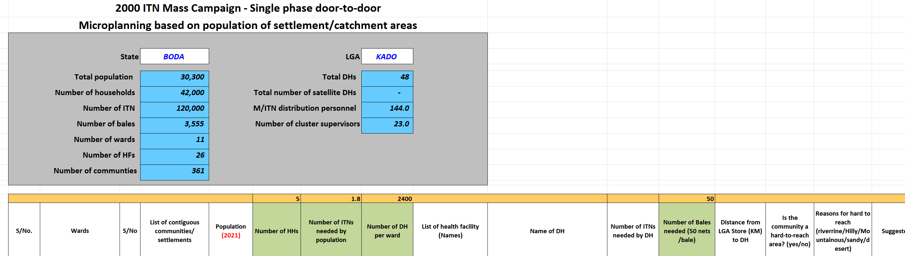
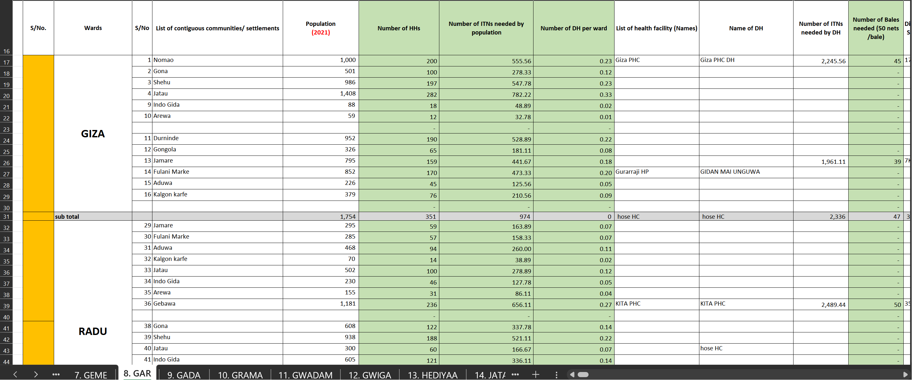

The module unmerges all cells, removes unwanted rows/columns, and populates the ward and Distribution Hub (DH) for every settlement:

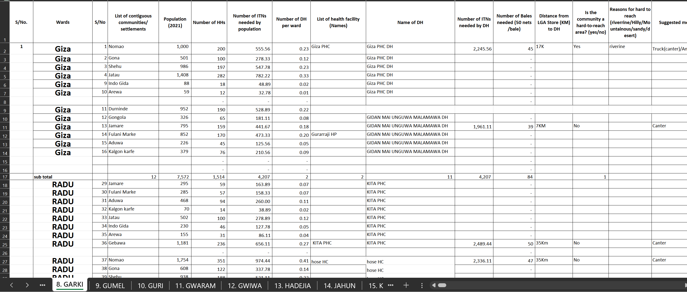

### PPS random cluster sampling for post-implementation revisits

After every campaign, a rapid assessment revisits randomly selected locations in each LGA. Manually, that means sorting wards by population, building a cumulative frequency, setting a PPS interval and random start, incrementing to select 8 clusters, then hand-picking a settlement and directions link per cluster — for every LGA:

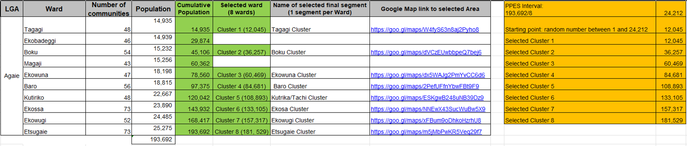
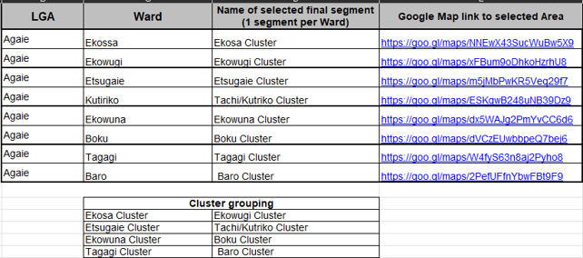

This module automates all seven steps and outputs each selected settlement with a ready-made Google Maps directions link. A random revisit point is generated inside the most built-up settlement extent of the selected ward (using GRID3 building counts), so field teams are sent somewhere that actually contains households:

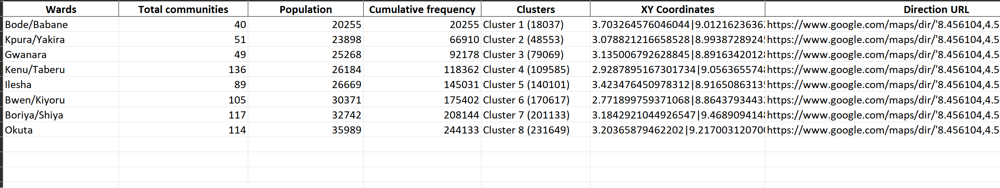

### Tracking data collection progress and validating point accuracy

- Validates that every captured settlement/DH point falls inside its declared ward boundary (`in_Ward` Yes/No)
- For misplaced points, computes the **ellipsoidal distance in km** to the correct ward and records the matching GRID3 ward name, then exports an Excel review file for supervisors
- Matches accurate points against the list of points to be captured and writes per-LGA Excel summaries: settlements captured per ward, settlements outstanding per ward, and totals

### Matching settlements to the GRID3 database

- Reshapes RedRose Collect field exports into clean settlement and DH tables (splitting GPS fields, mapping form questions to columns)
- Fuzzy-matches P3B settlement names against the GRID3 settlement database (`difflib`) so planned settlements inherit coordinates for spatial analysis

---

## 🗺 Built with PyQGIS

The spatial core of this project (`geo_script.py`) runs **QGIS headlessly** — no GUI, fully scripted:

- **Standalone QGIS bootstrap**: `QgsApplication` initialised without a desktop session, plus `Processing.initialize()` to make the full processing framework available from plain Python
- **Processing algorithms**: `qgis:selectbyexpression` (attribute-driven ward subsets) and `native:clip` (settlement extents clipped to ward boundaries), with a custom `QgsProcessingContext` set to `GeometryNoCheck` to survive imperfect real-world boundary data
- **Multiple data providers**: `ogr` for shapefiles, `delimitedtext` for CSV point loads, and in-memory layers for intermediate results
- **Geometry operations**: `contains()` for point-in-polygon ward checks, `centroid()` for revisit point generation, `nearestPoint()` for distance-to-ward
- **Geodesy**: `QgsDistanceArea` configured with the layer's ellipsoid for accurate km measurements
- **Schema editing**: adding and populating `QgsField` attributes (`in_Ward`, `dst_km`, `GRID3_Wrd`) via the data provider API
- **Interop**: converters between `QgsVectorLayer` and pandas DataFrames so spatial results flow straight into the Excel reporting pipeline

---

## 📂 Repository Structure

```
└── ITN/
    ├── Cluster/
    │   ├── cluster.py
    │   └── main.py
    ├── Matching/
    │   ├── main.py
    │   └── matching.py
    ├── Tracker/
    │   ├── main.py
    │   └── tracker.py
    ├── images/
    ├── geo_script.py
    ├── helper.py
    ├── main.py
    ├── notebook.ipynb
    ├── p3b.py
    └── requirements.txt
```

---

## ⚙️ Modules

**Root**

| File | Summary |
| --- | --- |
| [geo_script.py](geo_script.py) | PyQGIS spatial engine: headless QGIS init, processing algorithms (select by expression, clip), random revisit-point generation, point-in-ward validation with ellipsoidal distances, CSV↔layer↔DataFrame conversion |
| [helper.py](helper.py) | Shared configuration and lookups: paths to GRID3 datasets (settlement points, settlement extents, ward/LGA boundaries) and LGA/ward name mappings between data sources |
| [p3b.py](p3b.py) | P3B template cleaner: detects valid LGA sheets, unmerges cells, drops junk rows/columns, populates ward and DH per settlement, writes clean Excel output |
| [main.py](main.py) | Entry point for the P3B cleaning workflow |
| [notebook.ipynb](notebook.ipynb) | Exploratory notebook used during development |

**Cluster/**

| File | Summary |
| --- | --- |
| [cluster.py](Cluster/cluster.py) | PPS sampling: cumulative population frequency per ward, interval + random start, 8 clusters per LGA, random settlement selection with Google Maps directions link |
| [main.py](Cluster/main.py) | Entry point for cluster generation |

**Matching/**

| File | Summary |
| --- | --- |
| [matching.py](Matching/matching.py) | RedRose Collect export reshaping and fuzzy settlement-name matching against the GRID3 database |
| [main.py](Matching/main.py) | Entry point for the matching workflow |

**Tracker/**

| File | Summary |
| --- | --- |
| [tracker.py](Tracker/tracker.py) | Compares captured points vs. points to capture; writes per-LGA Excel reports of progress and outstanding settlements |
| [main.py](Tracker/main.py) | Entry point for tracking and point-accuracy validation |

---

## 🚀 Getting Started

***Dependencies***

- Python 3
- QGIS 3.32 (PyQGIS)
- pandas
- openpyxl

### 🔧 Installation

1. Clone the repository:

```sh
git clone https://github.com/Mrsatatima/ITN.git
```

2. Change to the project directory:

```sh
cd ITN
```

3. Install the dependencies:

```sh
pip install -r requirements.txt
```

> **Note**: PyQGIS ships with a QGIS install rather than pip. Run the scripts with the Python bundled with QGIS (e.g. via `python-qgis.bat` on Windows or the OSGeo4W shell), and update the QGIS prefix path at the top of `geo_script.py` to match your installation.

### Preparing the data

- Open `helper.py` and download the Nigeria settlement points CSV, settlement extent shapefile, and ward/LGA boundary shapefiles using the links in the comments:

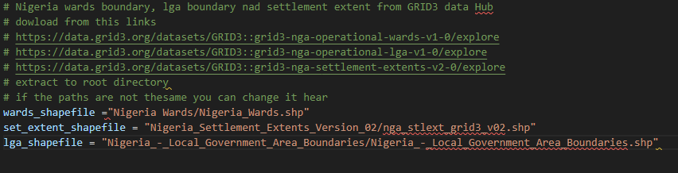

- Extract everything to the root directory.

### Cleaning the P3B template

- Open `main.py` and assign values to the variables shown:

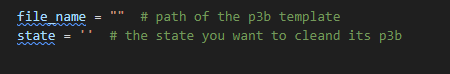

```sh
python main.py
```

- Output is written to the root directory.

### Creating 8 random settlement directions per LGA

- Open `Cluster/main.py` and assign values to the variables shown:

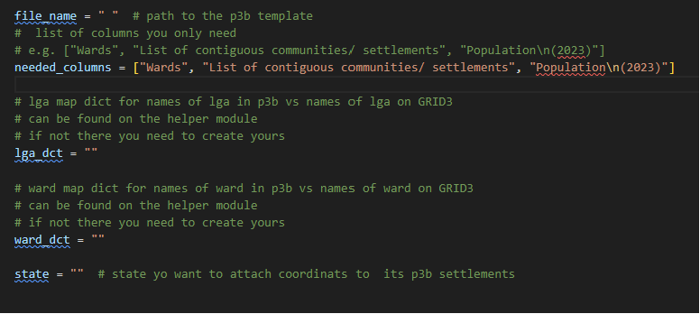

```sh
python -m Cluster.main
```

### Matching settlements

- Open `Matching/main.py` and assign values to the variables shown:

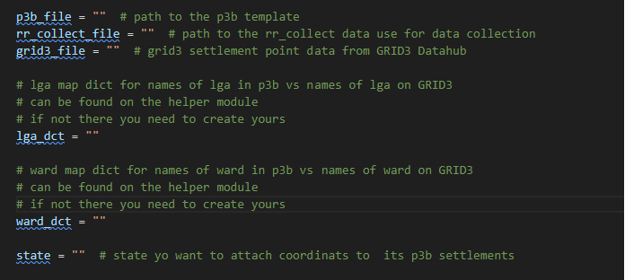

```sh
python -m Matching.main
```

### Tracking data collection and validating points

- Open `Tracker/main.py` and assign values to the variables shown:

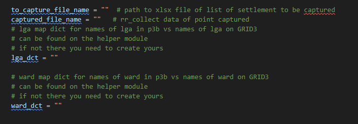

```sh
python -m Tracker.main
```

- Output is written to the `/lga/` directory.

---

## 🛣 Roadmap

- [ ] Move configuration (paths, QGIS prefix) out of code into a config file
- [ ] Package as a QGIS plugin / CLI tool
- [ ] Add unit tests for the cleaning and sampling logic

---

## 🤝 Contributing

Contributions are welcome:

- **[Submit Pull Requests](https://github.com/Mrsatatima/ITN/pulls)**: review open PRs or submit your own
- **[Report Issues](https://github.com/Mrsatatima/ITN/issues)**: file bugs or feature requests

---

## 📄 License

This project is released under the MIT License — see [LICENSE](LICENSE).

---

## 👏 Acknowledgments

- [GRID3](https://grid3.org/)
- [QGIS](https://qgis.org/en/site/)
